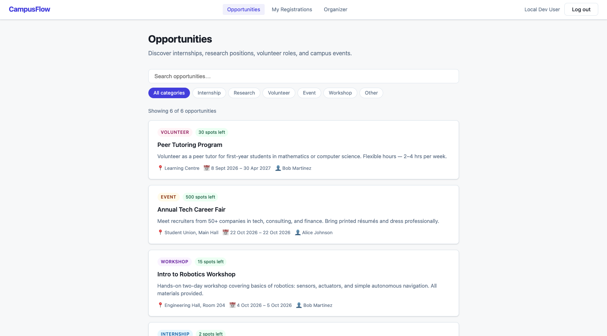
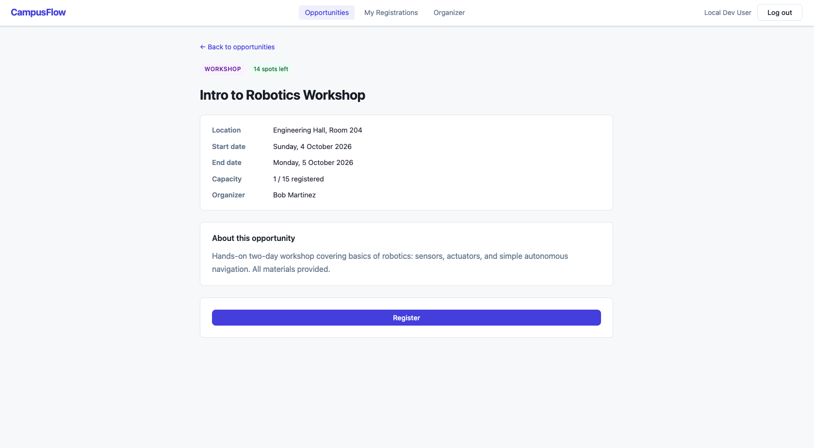
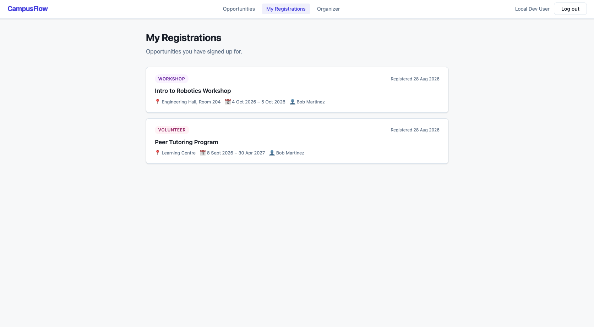
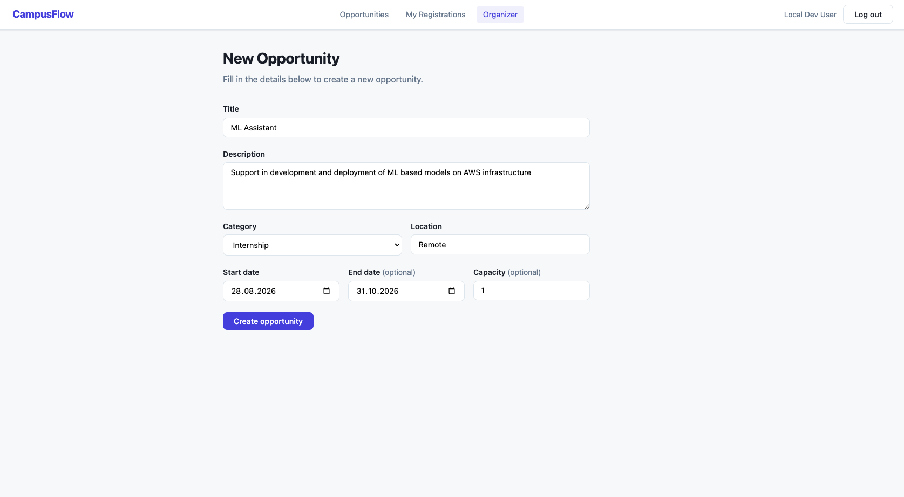
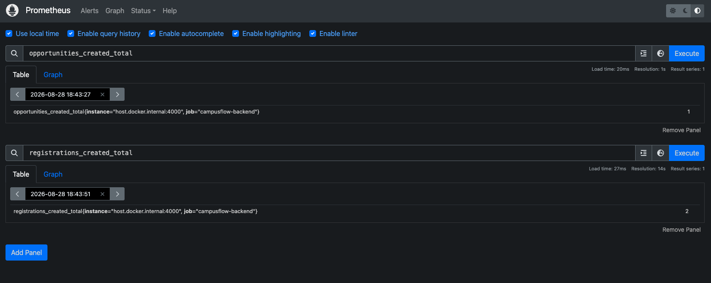

# CampusFlow

A full-stack student opportunities platform that connects students with campus events, internships, research positions, and volunteer opportunities.

Built as a production-grade portfolio project demonstrating modern web engineering practices: layered security, structured observability, infrastructure-as-code, and automated CI/CD.

---

## Table of Contents

- [Screenshots](#screenshots)
- [Features](#features)
- [Architecture](#architecture)
- [Tech Stack](#tech-stack)
- [Local Development](#local-development)
- [Running Tests](#running-tests)
- [Project Structure](#project-structure)
- [Documentation](#documentation)
- [Deployment](#deployment)

---

## Screenshots

**Opportunities listing** — browse and filter by category with keyword search



**Opportunity detail** — full description, location, dates, and registration button



**My Registrations** — authenticated student view of enrolled opportunities



**Organizer dashboard** — create, edit, and delete your own opportunities



**Prometheus dashboard** — real-time metrics: request rate, error rate, latency, and business counters



---

## Features

**Students**
- Browse published opportunities filtered by category (internship, research, volunteer, event, workshop)
- Search by keyword
- Register for opportunities with duplicate-prevention
- View their own registrations

**Organizers**
- Create, edit, and delete opportunities
- View the list of registered students per opportunity
- Own only their opportunities — cross-organizer modification is forbidden (403)

**Platform**
- Auth0 JWT authentication on all non-public endpoints
- Oso Cloud authorization with DB-ownership fallback for local development
- Input validation with whitelist stripping and type coercion
- Rate limiting (10 req/s burst, 100 req/min sustained)
- Security headers (Helmet), CORS origin allowlist
- Structured JSON logging (Splunk-compatible) with per-request correlation IDs
- Prometheus metrics endpoint with Grafana dashboard
- Terraform infrastructure on AWS (ECS Fargate, RDS, S3, CloudFront)
- GitHub Actions CI (lint + typecheck + test) and CD (build → push → deploy)

---

## Architecture

```
Browser
  │
  ├─ CloudFront (CDN)
  │    └─ S3 (React/Vite static assets)
  │
  └─ ALB (HTTPS)
       └─ ECS Fargate — NestJS backend
            ├─ RDS PostgreSQL 16
            └─ Secrets Manager (DATABASE_URL)

External services
  ├─ Auth0   — JWT issuance and JWKS key rotation
  └─ Oso Cloud — centralised authorization policy
```

Request flow through the backend:

```
Request
  └─ HttpLoggerMiddleware  (correlationId, structured log)
       └─ ThrottlerGuard   (rate limiting)
            └─ JwtAuthGuard (RS256 token verification)
                 └─ ValidationPipe (DTO whitelist + coercion)
                      └─ Controller
                           └─ Service
                                └─ AuthorizationService (Oso Cloud / DB fallback)
                                     └─ PrismaService (PostgreSQL)
```

---

## Tech Stack

| Layer | Technology |
|---|---|
| Frontend | React 18, TypeScript, Vite, TanStack Query, React Router |
| Backend | NestJS 10, TypeScript, Passport JWT, class-validator |
| Database | PostgreSQL 16, Prisma ORM |
| Auth | Auth0 (RS256 JWKS) |
| Authorization | Oso Cloud (Polar policy), DB fallback |
| Observability | Structured JSON logging, Prometheus + Grafana |
| Security | Helmet, CORS, `@nestjs/throttler`, `ValidationPipe` |
| Infrastructure | Terraform, AWS (ECS Fargate, RDS, S3, CloudFront, ECR, Secrets Manager) |
| CI/CD | GitHub Actions (OIDC, no long-lived AWS keys) |

---

## Local Development

### Prerequisites

- Node.js 22+
- Docker Desktop

### Start

```bash
# 1. Clone and enter the repo
git clone https://github.com/your-org/campusflow.git
cd campusflow

# 2. Start PostgreSQL (+ Prometheus + Grafana)
docker compose up -d

# 3. Backend
cd backend
cp .env.example .env        # fill in Auth0 values; leave OSO_CLOUD_API_KEY blank
npm install
npm run db:generate
npm run db:migrate
npm run db:seed             # optional seed data
npm run start:dev

# 4. Frontend (new terminal)
cd frontend
npm install
npm run dev
```

| Service | URL |
|---|---|
| Frontend | http://localhost:5173 |
| Backend API | http://localhost:4000/api |
| Health check | http://localhost:4000/api/health |
| Prometheus metrics | http://localhost:4000/metrics |
| Grafana dashboard | http://localhost:3000 (admin/admin) |
| Prometheus UI | http://localhost:9090 |

### Auth0 Setup (for full auth flow)

1. Create an Auth0 tenant and a Single Page Application.
2. Set **Allowed Callback URLs**, **Logout URLs**, and **Allowed Web Origins** to `http://localhost:5173`.
3. Create an API with the audience you'll use.
4. Fill in `AUTH0_DOMAIN` and `AUTH0_AUDIENCE` in `backend/.env`.
5. Create `frontend/.env.local`:
   ```
   VITE_AUTH0_DOMAIN=your-tenant.auth0.com
   VITE_AUTH0_CLIENT_ID=your-spa-client-id
   VITE_AUTH0_AUDIENCE=https://your-api-identifier
   VITE_API_URL=http://localhost:4000
   ```

### Without Auth0

Leave `AUTH0_DOMAIN` and `AUTH0_AUDIENCE` blank. All API endpoints that don't require auth (`GET /api/opportunities`, `GET /api/health`, `GET /metrics`) will still work. Authenticated endpoints will return 401.

---

## Running Tests

```bash
cd backend
npm test                   # run all tests once
npm run test:watch         # watch mode
npm run test:cov           # coverage report
npm run typecheck          # TypeScript type check
```

**36 tests across 7 suites:**

| Suite | Tests |
|---|---|
| `health.controller.spec.ts` | Health endpoint |
| `authorization.service.spec.ts` | Oso allow/deny, fact management |
| `users.controller.spec.ts` | JWT-based user upsert |
| `opportunities.controller.spec.ts` | Public listing and detail |
| `opportunities.organizer.spec.ts` | Create, update, delete, 403 scenarios |
| `registrations.controller.spec.ts` | Register, duplicate, listing |
| `auth-guard.spec.ts` | 401 for unauthenticated requests |

All external services (Auth0 JWKS, Oso Cloud, database) are mocked — tests run without any live credentials or infrastructure.

---

## Project Structure

```
campusflow/
├── .github/
│   └── workflows/
│       ├── ci.yml          # lint + typecheck + test on every PR
│       └── deploy.yml      # build → push ECR → deploy ECS + S3/CloudFront
│
├── backend/
│   ├── src/
│   │   ├── auth/           # JwtStrategy, JwtAuthGuard, @Public(), @CurrentUser()
│   │   ├── authorization/  # AuthorizationService (Oso Cloud + DB fallback)
│   │   ├── health/         # GET /api/health
│   │   ├── logger/         # AppLogger, HttpLoggerMiddleware
│   │   ├── metrics/        # MetricsService, MetricsController (/metrics)
│   │   ├── opportunities/  # CRUD + ownership + registrations view
│   │   ├── prisma/         # PrismaService
│   │   ├── registrations/  # student register + list
│   │   └── users/          # findOrCreate from JWT
│   ├── prisma/
│   │   ├── schema.prisma
│   │   ├── migrations/
│   │   └── seed.ts
│   ├── test/mocks/         # shared Jest mocks (authz, logger, metrics)
│   ├── oso/policy.polar    # Polar authorization policy
│   ├── Dockerfile
│   └── .env.example
│
├── frontend/
│   └── src/
│       ├── api/            # typed fetch client
│       ├── auth/           # AuthProvider, RequireAuth
│       ├── components/     # Navbar, OpportunityCard, OpportunityForm, …
│       ├── hooks/          # useOpportunities, useRegistrations, …
│       ├── pages/          # route-level components
│       └── types/          # Opportunity, Registration interfaces
│
├── infrastructure/
│   ├── terraform/
│   │   ├── modules/
│   │   │   ├── networking/ # VPC, subnets, NAT gateways
│   │   │   ├── database/   # RDS, Secrets Manager
│   │   │   ├── backend/    # ECR, ECS, ALB, IAM, GitHub OIDC role
│   │   │   └── frontend/   # S3, CloudFront
│   │   └── terraform.tfvars.example
│   ├── prometheus/
│   │   └── prometheus.yml
│   └── grafana/
│       └── provisioning/   # auto-provisioned datasource + dashboard
│
├── docs/
│   ├── architecture.md
│   ├── authorization.md
│   ├── ci-cd.md
│   ├── infrastructure.md
│   ├── logging.md
│   ├── monitoring.md
│   └── security.md
│
└── docker-compose.yml      # PostgreSQL + Prometheus + Grafana
```

---

## Documentation

| Document | Contents |
|---|---|
| [Architecture](docs/architecture.md) | System diagram, request flow, design decisions |
| [Authorization](docs/authorization.md) | Oso Cloud policy, roles, permissions, 403 scenarios |
| [Security](docs/security.md) | Defence layers, headers, CORS, rate limiting, validation |
| [Logging](docs/logging.md) | JSON log format, correlation IDs, event catalog |
| [Monitoring](docs/monitoring.md) | Prometheus metrics, Grafana dashboard panels |
| [Infrastructure](docs/infrastructure.md) | AWS architecture, Terraform modules, deploy runbook |
| [CI/CD](docs/ci-cd.md) | Workflow overview, OIDC setup, GitHub secrets |

---

## Deployment

See [docs/infrastructure.md](docs/infrastructure.md) for the full Terraform runbook and [docs/ci-cd.md](docs/ci-cd.md) for the GitHub Actions setup.

**Quick reference:**

```bash
# Provision AWS infrastructure
cd infrastructure/terraform
cp terraform.tfvars.example terraform.tfvars   # fill in values
terraform init
terraform apply

# After apply, set GitHub secrets from terraform outputs:
terraform output github_deploy_role_arn
terraform output cloudfront_distribution_id
terraform output s3_bucket_name
terraform output ecr_repository_url

# Every push to main then automatically:
# 1. Runs CI (lint + typecheck + test)
# 2. Builds and pushes the backend Docker image to ECR
# 3. Deploys the new image to ECS (with rollback on failure)
# 4. Builds the frontend and syncs to S3 + invalidates CloudFront
```
